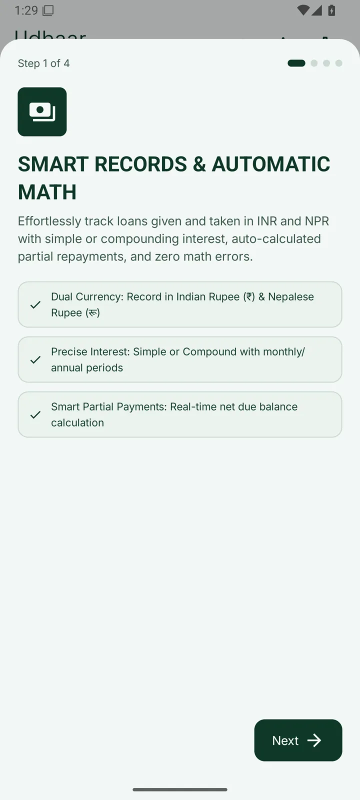
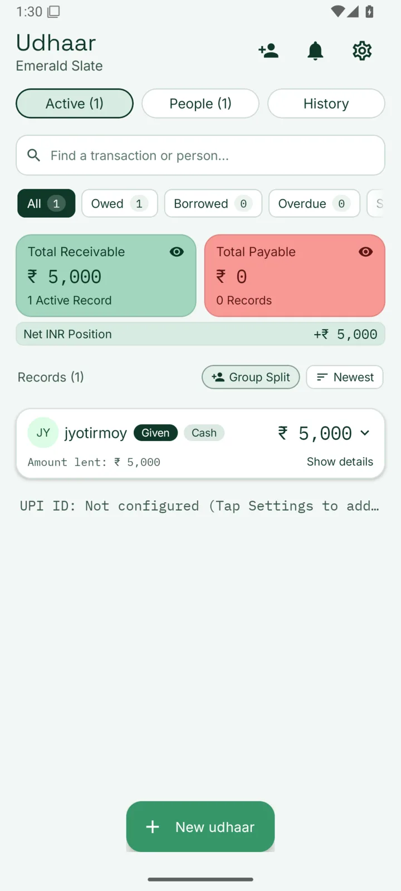
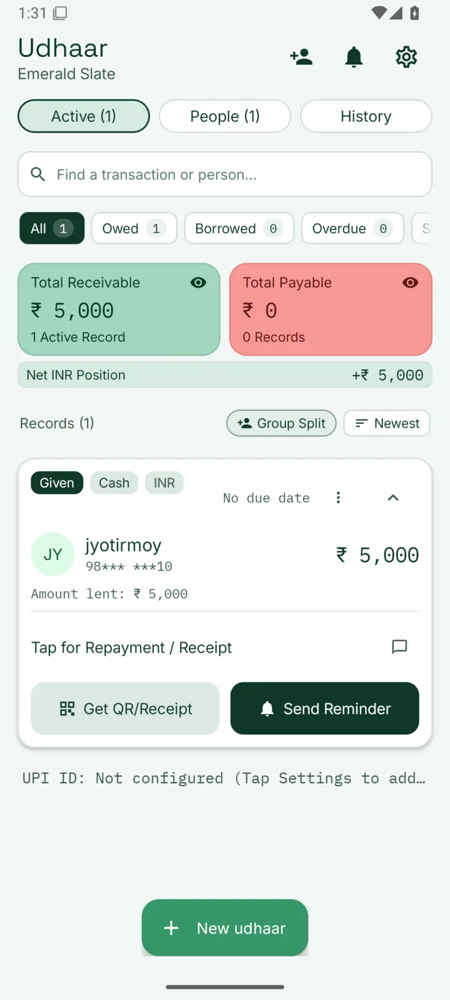
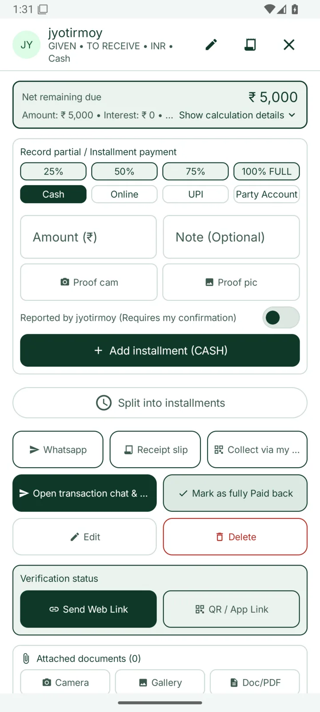
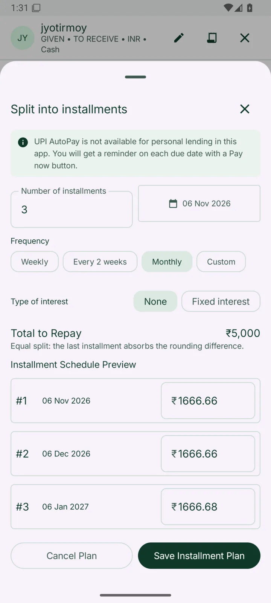
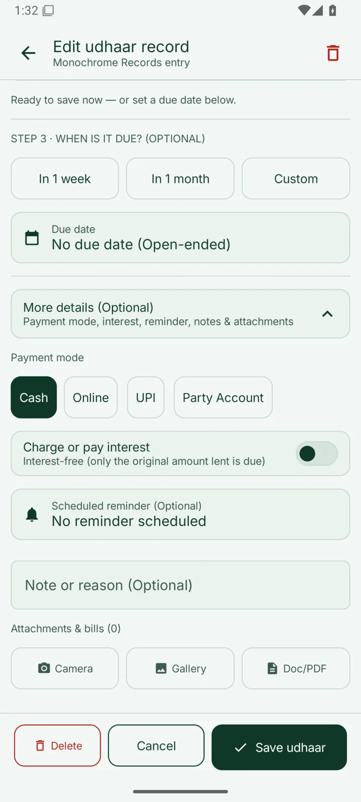
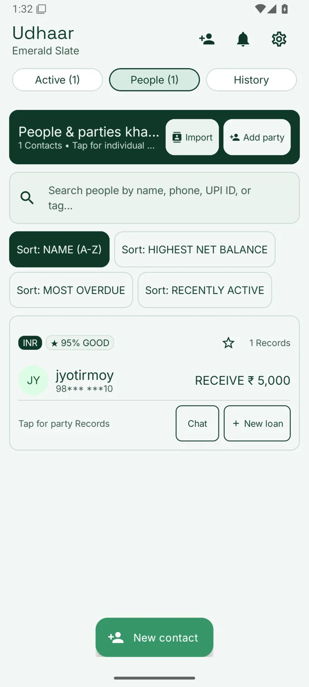
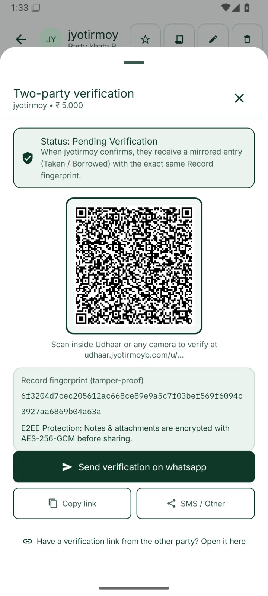
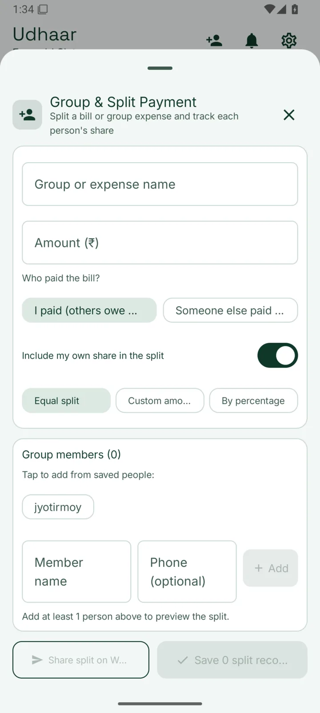

# Udhaar v29.0 (Spark Mode) — Offline-First Personal Loan & Khata Platform

[](https://github.com/JyotirmoyBhowmik/Udhaar/actions/workflows/ci.yml)
[-039be5?logo=firebase)](docs/OPERATIONS.md)
[](docs/SECURITY.md)
[](docs/PLAY_DATA_SAFETY.md)

**Udhaar** (`com.jyotirmoyb.udhaar`, `versionName = "29.0"`, `versionCode = 29` via `version.properties`, Room Schema `v13`) is an offline-first personal loan and khata platform for Android and the Web. It tracks **Given / Owed** and **Taken / Borrowed** records across **Indian Rupees (`INR ₹`)** and **Nepalese Rupees (`NPR रू`)** in **5 languages** (`English`, `Hindi`, `Bengali`, `Assamese`, and `Nepali`) and **8 visual themes**.

Udhaar runs 100% on the **Firebase Spark (Free) Tier** (`UDHAAR_TIER = "spark"`, `BLAZE_FEATURES_ENABLED = false`) with **zero server-side Cloud Functions, zero Secret Manager secrets, zero Cloud KMS keys, and zero Cloud Storage buckets** in production. Spark cloud sync, guest verification links, and cloud data deletion are enabled by default (`BuildConfig.CLOUD_FEATURES = true`, opt-out via `-Pudhaar.cloudFeatures=false`).

---

## 1. Screenshots & Interface Walkthrough

| Onboarding & Setup | Compact v19 Dashboard | Expanded Record Card |
| :---: | :---: | :---: |
|  |  |  |
| **Record Detail & Ledger** | **Installment Planner** | **Add / Edit Record (`<= 560 dp`)** |
|  |  |  |
| **People Directory** | **UPI QR & Receipts** | **Group Split Calculator** |
|  |  |  |

---

## 2. Spark Mode Architecture Diagram

```text
┌──────────────────────────────────────────────────────────────────────────────┐
│                        ANDROID APP (com.jyotirmoyb.udhaar)                   │
│                     versionCode = 29 | versionName = "29.0"                  │
│          UDHAAR_TIER = "spark" | BuildConfig.CLOUD_FEATURES = true           │
│                                                                              │
│  ┌──────────────────────────────┐      ┌──────────────────────────────────┐  │
│  │ Jetpack Compose UI (M3)      │      │ Hardware-Backed Local Security   │  │
│  │ • >= 600 dp Two-Pane Layout  │      │ • BiometricPrompt + PBKDF2 PIN   │  │
│  │ • <= 560 dp Form Width Cap   │      │ • SQLCipher 256-bit Room DB v13  │  │
│  │ • >= 48 dp Touch Targets     │      │ • EncryptedSharedPreferences     │  │
│  └──────────────┬───────────────┘      └─────────────────┬────────────────┘  │
│                 │                                        │                   │
│                 ▼                                        ▼                   │
│  ┌──────────────────────────────┐      ┌──────────────────────────────────┐  │
│  │ Exact Paise Engine (Long)    │      │ AES-256-GCM Backup Engine        │  │
│  │ • 100 paise = ₹1.00 / रू1.00 │      │ • Local .udhaar / JSON / PDF     │  │
│  │ • Simple/Compound Interest   │      │ • Google Drive appDataFolder     │  │
│  │ • Installments & Group Split │      │ • 24-char Recovery Key           │  │
│  └──────────────┬───────────────┘      └──────────────────────────────────┘  │
└─────────────────┼────────────────────────────────────────────────────────────┘
                  │  (Optional — only when BuildConfig.CLOUD_FEATURES = true
                  │   AND Firebase Auth email_verified == true)
                  ▼
┌──────────────────────────────────────────────────────────────────────────────┐
│                     FIREBASE SPARK (FREE TIER) BACKEND                       │
│     Deployed via: firebase deploy --only hosting,firestore:rules,indexes     │
│      (NO Cloud Functions • NO Secret Manager • NO Cloud KMS • NO Storage)    │
│                                                                              │
│  ┌─────────────────────────┐  ┌───────────────────────────────────────────┐  │
│  │ Firebase Authentication │  │ Cloud Firestore (firestore.rules)         │  │
│  │ • Google Sign-In        │  │ • /users/{uid} (isVerifiedOwner)          │  │
│  │ • Email/Password +      │  │ • /users/{uid}/records|people|plans|      │  │
│  │   Email Verification    │  │   attachments|events|meta/syncSignal      │  │
│  │ • Anonymous Auth        │  │ • /guestLinks/{linkId} (128-bit ID)       │  │
│  │   (Guest links only)    │  │ • /guestLinks/{linkId}/actions/{actionId} │  │
│  └────────────┬────────────┘  └─────────────────────┬─────────────────────┘  │
│               │                                     │                        │
│               ▼                                     ▼                        │
│  ┌───────────────────────────────────┐ ┌──────────────────────────────────┐  │
│  │ Web Companion (/ledger/)          │ │ Counterparty Guest Page (/u/)    │  │
│  │ • Bundled Firebase JS SDK v11.3.0 │ │ • Anonymous Auth + getDoc(link)  │  │
│  │ • Offline IndexedDB Outbox        │ │ • Fixed-ID Action Proposals:     │  │
│  │ • WebCrypto AES-256-GCM           │ │   confirm, dispute, claim_1..5,  │  │
│  └───────────────────────────────────┘ │   date_1..3                      │  │
│                                        └──────────────────────────────────┘  │
└──────────────────────────────────────────────────────────────────────────────┘
```

---

## 3. What Matches the Code in v29.0 (Truth & Architecture Summary)

- **Version & Build Flags (`version.properties` & `app/build.gradle.kts`):**
  - `namespace = "com.jyotirmoyb.udhaar"` and `applicationId = "com.jyotirmoyb.udhaar"`.
  - Explicit monotonic versioning from `version.properties` (`versionCode = 29`, `versionName = "29.0"`) plus CI run-number base (`100 + GITHUB_RUN_NUMBER`); `verifyReleaseVersioning` fails release builds if missing, invalid, or `< 28`.
  - `firebase-appcheck-debug` is strictly `debugImplementation` only, guarded by `verifyReleaseNoDebugAppCheck` and release-variant `AppCheckProviderInstaller.kt` (Play Integrity only).
  - `UDHAAR_TIER = "spark"`, `CLOUD_FEATURES = true` (opt-out via `-Pudhaar.cloudFeatures=false`), and `BLAZE_FEATURES_ENABLED = false` by default.
  - R8 minification (`isMinifyEnabled = true`) and resource shrinking (`isShrinkResources = true`) are **ON by default** on the `release` build type, enforced by the `verifyReleaseR8` Gradle task before `bundleRelease`.
  - Detekt static analysis (`config/detekt/detekt.yml`) runs in CI, `AccountAndWebAccessSection.kt` is modularized into files `< 600` lines, and all custom vector icons live under `com.jyotirmoyb.udhaar.ui.icons.UdhaarIcons` (zero `androidx` package squatting).
- **Exact Paise Money Engine (`Long` Minor Units Only):**
  - Every financial entity (`UdhaarTransaction`, `PartialPayment`, `InstallmentPlan`, `Installment`), DAO query, interest calculation (`InterestCalculator`), installment schedule (`InstallmentCalculator`), and group split (`GroupSplitCalculator`) uses integer `Long` paise (`100 paise = ₹1.00 / रू1.00`) with `BigDecimal` + `RoundingMode.HALF_UP`.
- **Real Adaptive Tablet & Landscape Layouts + `>= 48 dp` Touch Targets:**
  - **Two-Pane List + Detail at `>= 600 dp`:** `DashboardScreen.kt` (`dashboard_adaptive_two_pane` + `DashboardAdaptiveDetailPane`) and `PeopleDirectoryScreen.kt` (`people_adaptive_detail_pane` + `PartyDetailSummaryCard`) render a side-by-side list (`0.55f` weight) and detail pane (`0.45f` weight) whenever `maxWidth >= 600.dp`.
  - **Form Width Cap (`<= 560 dp`):** `AddEditUdhaarScreen.kt` constrains both the scrollable form (`adaptive_centered_form_container`) and bottom action bar to `Modifier.widthIn(max = 560.dp)`.
  - **Landscape Support:** `DashboardScreen.kt` adapts to landscape viewports (`maxWidth > maxHeight`, `dashboard_landscape_root`).
  - **`>= 48 dp` Touch Targets at `fontScale = 2.0`:** All interactive buttons, chips, icon buttons (`AppIconButton`), and switches (`UdhaarAnimatedSwitch`) use `heightIn(min = 48.dp)` or `sizeIn(minWidth = 48.dp, minHeight = 48.dp)` rather than fixed `< 48.dp` heights, verified by automated Robolectric Compose tests at `fontScale = 2.0f`.
- **Spark Mode Cloud Auth, Sync, Guest Links & Data Deletion:**
  - **No Cloud Functions, Secret Manager, KMS, or Storage Signed URLs:** Spark Mode uses zero `/api/*` endpoints in production. Both `.github/workflows/deploy-prod.yml` and `.github/workflows/deploy-staging.yml` deploy only `hosting,firestore:rules,firestore:indexes`.
  - **Firebase Auth (`AccountAndWebAccessSection.kt` & `webapp/src/firebaseClient.js`):** Supports Google Sign-In (`CredentialManager` on Android, `signInWithPopup` on Web) and Email/Password with mandatory `sendEmailVerification()`, `sendPasswordResetEmail()`, and re-authentication. Cloud sync stays disabled until `emailVerified == true`.
  - **Counterparty Guest Capability Links (`web/u/guest.js`):** Uses Firebase Anonymous Auth (`signInAnonymously`), reads `/guestLinks/{linkId}` directly via `getDoc` (`allow list: if false`), and writes append-only action proposals under `/guestLinks/{linkId}/actions/{actionId}` using capped IDs (`confirm`, `dispute`, `claim_1`..`claim_5`, `date_1`..`date_3`). `GuestActionPollingWorker.kt` polls actions via `collectionGroup("actions").whereEqualTo("ownerUid", uid)`.
  - **In-App Help & Contact + Spark Cloud Data Deletion:**
    - **Help & Contact (`HelpAndContactSheet.kt`):** Accessible from **Settings $\rightarrow$ About $\rightarrow$ Help & Contact**, providing 1-tap email links to Support (`admin@jyotirmoyb.com`) and the Grievance Officer (`grievance@jyotirmoyb.com`), Spark Mode FAQs, Privacy Policy, and Terms of Service.
    - **Delete My Cloud Data (`AccountAndWebAccessSection.kt`):** Permanently deletes all cloud documents under `/users/{uid}` (`records`, `people`, `plans`, `attachments`, `meta/syncSignal`, and the profile document) plus the user's `/guestLinks/{linkId}` documents directly via the Firebase Firestore SDK in Spark Mode, while keeping the local encrypted Room database intact.

---

## 4. Spark Mode Limits & Quota Boundaries

Because Udhaar v29.0 runs on the **Firebase Spark (Free) Plan** with zero server-side billing required, the following architectural and quota limits apply:

1. **Spark Cloud Features Enabled by Default (`BuildConfig.CLOUD_FEATURES = true`, `BLAZE_FEATURES_ENABLED = false`):**
   - Local-first mode (`SQLCipher` Room DB + local `.udhaar` / JSON / PDF exports + encrypted Google Drive `appDataFolder` backups) works with zero sign-in; optional Spark Firebase Auth / Firestore sync and counterparty guest web links are enabled out of the box on the Firebase free tier (pass `-Pudhaar.cloudFeatures=false` for an offline-only build).
2. **Firebase Spark Daily Firestore Quotas (Shared Across Project):**
   - **50,000 document reads / day**, **20,000 document writes / day**, **20,000 document deletes / day**, and **1 GiB total Firestore storage**.
   - **Mitigation:** Udhaar uses delta-only watermarks (`updatedAtMs > lastSyncMs`) and a single `/users/{uid}/meta/syncSignal` document listener instead of broad collection listeners.
3. **Document Size & Schema Caps (`firestore.rules`):**
   - User profile (`/users/{uid}`): max `30` keys.
   - Ledger record (`/users/{uid}/records/{recordId}`): max `60` keys, monotonic revision (`rev == resource.data.rev + 1`).
   - Party (`/users/{uid}/people/{personId}`), Plan (`/plans/{planId}`), Attachment metadata (`/attachments/{attId}`): max `25–40` keys.
   - Guest capability link (`/guestLinks/{linkId}`): max `40` keys; directory listing (`list`) is strictly forbidden (`allow list: if false`).
4. **Capped Guest Proposals per Link (`10` Fixed Action IDs Maximum):**
   - Each shared guest link accepts at most **1 confirmation** (`confirm`), **1 dispute** (`dispute`), **5 payment claims** (`claim_1`..`claim_5`), and **3 due-date proposals** (`date_1`..`date_3`).
   - Action documents are strictly append-only (`allow update, delete: if false`); once all 5 payment claim slots or 3 date proposal slots are used on a link, the lender must issue a fresh link if additional guest proposals are needed.
5. **No Cloud Blob Storage for Proof Images in Spark Mode:**
   - Receipt photos and PDF attachments are stored locally on-device and inside encrypted Google Drive `appDataFolder` backups. Firestore stores only compact attachment metadata and SHA-256 hashes (`/users/{uid}/attachments/{attId}`).
6. **No Server-Side SMS / WhatsApp Gateway:**
   - Reminders and guest links are shared directly from the user's device via Android `Intent.ACTION_SEND` / WhatsApp deep links (`wa.me`) or system share sheets.

---

## 5. Build, Test & Deploy Steps

### Prerequisites
- **Android:** JDK 17+, Android SDK 36 (`compileSdk = 36`, `targetSdk = 36`, `minSdk = 24`), Gradle.
- **Web & Rules Tests:** Node.js 20+, npm, `firebase-tools` (for Firestore/Auth emulator runs and hosting deployment).

### A. Build Commands (Android & Web)
```bash
# 1. Build Web Landing, Legal Pages (/privacy.html, /terms.html), Guest Portal (/u/), and WebApp (/ledger/)
npm install --ignore-scripts
npm run build

# 2. Compile Debug Android APK (Spark Mode, CLOUD_FEATURES = true default)
gradle assembleDebug

# 3. Compile Offline-Only Debug Android APK (CLOUD_FEATURES = false)
gradle assembleDebug -Pudhaar.cloudFeatures=false

# 4. Build Signed Release App Bundle (AAB) with R8 & Resource Shrinking Verified
gradle :app:verifyReleaseR8 :app:bundleRelease
```

### B. Test Commands (Unit, Robolectric @ fontScale 2.0, Firestore Rules, Web & E2E)
```bash
# 1. Verify Launch Checklist & Documentation Proof Gate
node scripts/verify-launch-checklist.js

# 2. Verify 5-Language Web i18n Completeness (en, hi, bn, as, ne)
npm run check:i18n

# 3. Run Spark Firestore Rules, Web Client, Legal Pages (Privacy + Terms in 5 languages), and Release Gate Tests
node --test \
  functions/test/firestore_rules.test.js \
  functions/test/web_client.test.js \
  functions/test/landing_privacy_page.test.js \
  functions/test/stage_r0_truth.test.js \
  functions/test/stage_s10_release.test.js

# 4. Run Spark Firestore Security Rules Suite Against Live Firebase Auth & Firestore Emulators
npx firebase emulators:exec --project demo-udhaar --only auth,firestore \
  "node --test functions/test/firestore_rules.test.js"

# 5. Run Android JVM Unit & Robolectric Tests (Paise engine, Room migrations 1->12,
#    adaptive >=600dp layout, <=560dp form cap, >=48dp touch targets at fontScale=2.0,
#    Spark Auth & Delete My Cloud Data, Help & Contact sheet)
gradle :app:testDebugUnitTest
```

### C. Deploy Steps (Firebase Spark Free Tier Only)
```bash
# 1. Build production web assets into web/
npm run build

# 2. Deploy ONLY Hosting, Firestore Security Rules, and Firestore Indexes (100% Spark-safe)
npx firebase deploy \
  --only hosting,firestore:rules,firestore:indexes \
  --project <YOUR_FIREBASE_PROJECT_ID>
```

### D. Firebase Console Setup Checklist (Spark Free Tier)
To enable the two honest verification levels for web guest confirmation links without Blaze billing:
1. Open [Firebase Console](https://console.firebase.google.com/) and select your project.
2. Navigate to **Build** &rarr; **Authentication** &rarr; **Sign-in method** tab.
3. **Enable Anonymous Provider**: Click **Anonymous**, toggle **Enable**, and click **Save**. This powers **LEVEL A ("PRIVATE_LINK")** capability URLs.
4. **Enable Google Provider**: Click **Google**, toggle **Enable**, select the project support email, and click **Save**. This powers **LEVEL B ("GOOGLE_VERIFIED")** where rules cryptographically check email hashes and `email_verified == true`.
5. Under **Authorized domains**, ensure your custom hosting domain (`udhaar.jyotirmoyb.com`) and `localhost` are listed.

---

## 6. Open-Source Governance, Legal & Support Contacts

- **License:** See [`LICENSE`](LICENSE) in the repository root.
- **Operations & Spark Monitoring Runbook:** See [`docs/OPERATIONS.md`](docs/OPERATIONS.md).
- **Security Policy & Vulnerability Reporting:** See [`SECURITY.md`](SECURITY.md).
- **Google Play Data Safety Audit:** See [`docs/PLAY_DATA_SAFETY.md`](docs/PLAY_DATA_SAFETY.md).
- **Contributing Guidelines:** See [`CONTRIBUTING.md`](CONTRIBUTING.md).
- **Live Privacy Policy (5 Languages):** [`https://udhaar.jyotirmoyb.com/privacy.html`](https://udhaar.jyotirmoyb.com/privacy.html) (`web/privacy.html`)
- **Live Terms of Service (5 Languages):** [`https://udhaar.jyotirmoyb.com/terms.html`](https://udhaar.jyotirmoyb.com/terms.html) (`web/terms.html`)
- **Support Contact:** `admin@jyotirmoyb.com`
- **Grievance Officer (DPDP Act 2023 & IT Rules):** Jyotirmoy Bhowmik — `grievance@jyotirmoyb.com`
