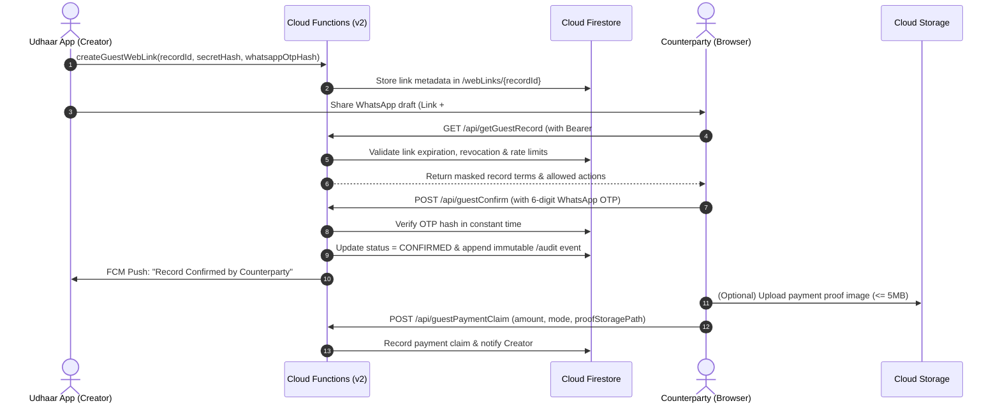

# Udhaar — Guest Web Flow Setup & Deployment Guide

This guide provides end-to-end instructions for deploying, configuring, testing, and maintaining the **Udhaar Guest Web Flow** across Firebase Cloud Functions (v2), Cloud Firestore (named database), Firebase Hosting, and the Android client application.

---

## 1. System Architecture & Interaction Flow

The Guest Web Flow enables counterparties to view, confirm, dispute, and submit payment claims for ledger records in a mobile-first browser interface without installing the app or creating an account.



---

## 2. Prerequisites & Environment Setup

### 2.1 Tooling Requirements
- **Node.js:** v20.x or higher (`node --version`)
- **Firebase CLI:** v13.x or higher (`npm install -g firebase-tools`)
- **Google Cloud SDK:** Recommended for TTL policy management (`gcloud --version`)

### 2.2 Project & Database Identifiers
- **Firebase Project ID:** `gen-lang-client-0216629575`
- **Named Firestore Database ID:** `ai-studio-android-udhaar-42622035-52d2-4bfb-8070-8962975a82cf`
- **Cloud Functions Region:** `asia-south1` (Mumbai, India)
- **Production Custom Domain:** `https://udhaar.jyotirmoyb.com`
- **Verification Portal Base URL:** `https://udhaar.jyotirmoyb.com/u/`

---

## 3. Configuration Files Overview

### 3.1 `firebase.json` Hosting & Function Rewrites
The root `firebase.json` routes `/u/**` paths to the single-page application `web/u/index.html` and maps API calls directly to Cloud Functions:

```json
{
  "firestore": {
    "rules": "firestore.rules"
  },
  "hosting": {
    "public": "web",
    "headers": [
      {
        "source": "/u/**",
        "headers": [
          { "key": "Cache-Control", "value": "no-store, no-cache, must-revalidate, proxy-revalidate" },
          { "key": "X-Frame-Options", "value": "DENY" },
          { "key": "X-Content-Type-Options", "value": "nosniff" },
          { "key": "Referrer-Policy", "value": "no-referrer" },
          { "key": "Permissions-Policy", "value": "geolocation=(), microphone=(), camera=()" }
        ]
      }
    ],
    "rewrites": [
      { "source": "/u/r/**", "destination": "/u/index.html" },
      { "source": "/u/**", "destination": "/u/index.html" },
      { "source": "/api/getGuestRecord", "function": { "functionId": "getGuestRecord", "region": "asia-south1" } },
      { "source": "/api/guestConfirm", "function": { "functionId": "guestConfirm", "region": "asia-south1" } },
      { "source": "/api/guestDispute", "function": { "functionId": "guestDispute", "region": "asia-south1" } },
      { "source": "/api/guestPaymentClaim", "function": { "functionId": "guestPaymentClaim", "region": "asia-south1" } },
      { "source": "/api/guestProposeDate", "function": { "functionId": "guestProposeDate", "region": "asia-south1" } },
      { "source": "/api/guestSetUpi", "function": { "functionId": "guestSetUpi", "region": "asia-south1" } },
      { "source": "**", "destination": "/index.html" }
    ]
  }
}
```

### 3.2 Cloud Functions Environment Parameters
In `functions/guestWebFlowEndpoints.js`, the named database parameter defaults to `ai-studio-android-udhaar-42622035-52d2-4bfb-8070-8962975a82cf` and can also be defined via environment parameter:
```bash
firebase functions:params:set FIRESTORE_DATABASE_ID="ai-studio-android-udhaar-42622035-52d2-4bfb-8070-8962975a82cf"
```

---

## 4. Step-by-Step Deployment Instructions

### Step 1: Firebase CLI Authentication & Project Selection
```bash
# 1. Sign in to your authorized Google account
firebase login

# 2. Set the active Firebase project
firebase use gen-lang-client-0216629575

# 3. Verify target configuration
firebase target
```

### Step 2: Deploy Firestore Security Rules
Ensure client apps cannot read or write `/webLinks` or `/audit` directly:
```bash
firebase deploy --only firestore:rules
```
*Verification:* Run `npm test --prefix functions` to verify all security rules tests pass.

### Step 3: Deploy Firebase Cloud Functions (v2)
Deploy all HTTP endpoints, callables, push triggers, and the daily retention scheduler:
```bash
# Install node dependencies
npm install --prefix functions

# Deploy all functions in asia-south1
firebase deploy --only functions
```

### Step 4: Deploy Firebase Hosting (Web Portal & Digital Asset Links)
Deploy the landing page, privacy policy, and guest portal assets:
```bash
firebase deploy --only hosting
```

### Step 5: Full Combined Production Deployment
To deploy all components simultaneously:
```bash
firebase deploy --only functions,hosting,firestore:rules
```

---

## 5. Local Emulator Testing

You can run the entire Firebase stack locally without touching production databases:

```bash
# Start Cloud Functions, Firestore, and Hosting emulators
firebase emulators:start --only functions,firestore,hosting
```

Once running:
- **Hosting URL:** `http://localhost:5000/u/`
- **Functions Emulator:** `http://127.0.0.1:5001/gen-lang-client-0216629575/asia-south1/`
- **Emulator UI:** `http://localhost:4000`

### Running the Automated Test Suites & Build Pipeline

1. **Internationalization & Plain-Language Linter:**
   Validates that all Android string files (`values`, `values-hi`, `values-bn`, `values-as`, `values-ne`) and web dictionaries (`web/landing.js`, `web/u/guest.js`) have 100% complete coverage, zero untranslated English strings, zero banned technical jargon words, and zero disallowed ALL CAPS:
   ```bash
   npm run check:i18n
   ```
   Expected output: **🎉 SUCCESS: All 5 languages verified! Zero missing keys, zero untranslated text, zero jargon!**

2. **Web Production Build & Asset Integrity Pipeline:**
   Builds, validates bundle budgets (landing page &lt;= 600 KB, guest portal &lt;= 250 KB), generates hash manifests (`web/dist-manifest.json`), and verifies CSP compliance (zero inline styles, zero inline scripts):
   ```bash
   npm run build
   ```
   Expected output: **🎉 SUCCESS: Web production build passed all performance, security, and budget audits!**

3. **Image Optimization & Responsive WebP Generation:**
   Optimizes web images into responsive WebP variants (480px, 800px, 1200px) with `srcset`:
   ```bash
   npm run optimize:images
   ```

4. **Multi-Browser E2E, Visual Regression & axe-core Accessibility Audits:**
   Executes Playwright tests across Chromium, Firefox, and WebKit on mobile (360px), tablet (768px), and desktop (1280px) viewports across all 5 regional languages, verifying interactive flows, integer-paise calculator math, and zero critical/serious accessibility violations:
   ```bash
   npm run test:e2e
   ```
   Expected output: **12 passing tests (0 failures)**.

5. **Complete Web & Cloud Functions Test Suite:**
   Runs unit tests, security rules validation, repayment calculator math, and full browser automated tests:
   ```bash
   npm test
   ```
   Expected output: **54 passing tests (0 failures)**.

6. **Android Unit & Robolectric Suite:**
   Validates database migrations, crypto operations, view models, and UI contracts:
   ```powershell
   .\gradlew.bat testDebugUnitTest
   ```
   Expected output: **BUILD SUCCESSFUL (all unit and Robolectric tests passing, 0 failures)**.

---

## 6. Custom Domain & Android App Links Setup

### 6.1 Custom Domain DNS Configuration
To route `udhaar.jyotirmoyb.com` through Firebase Hosting:
1. Open **Firebase Console &rarr; Hosting &rarr; Custom Domains &rarr; Add custom domain**.
2. Enter `udhaar.jyotirmoyb.com`.
3. Add the provided DNS `A` records or `CNAME` in your DNS registrar (e.g., Cloudflare, Route53, Namecheap):
   - `CNAME udhaar -> gen-lang-client-0216629575.web.app`

### 6.2 Digital Asset Links (`assetlinks.json`)
The file `web/.well-known/assetlinks.json` enables Android App Links so tapping `https://udhaar.jyotirmoyb.com/u/r/...` opens directly in the installed Udhaar app:
```json
[
  {
    "relation": ["delegate_permission/common.handle_all_urls"],
    "target": {
      "namespace": "android_app",
      "package_name": "com.jyotirmoyb.udhaar",
      "sha256_cert_fingerprints": [
        "FD:AD:95:C3:89:A1:C2:2A:28:18:C8:58:C9:65:C8:30:C7:57:04:AC"
      ]
    }
  }
]
```
To verify on a physical Android device:
```bash
adb shell pm get-app-links com.jyotirmoyb.udhaar
```

---

## 7. Zero-Cost WhatsApp Architecture & Quota Guarantees

Udhaar enforces strict architectural guardrails to guarantee **zero cellular SMS costs** and minimize cloud compute footprint:

1. **Zero SMS Cost:** No cellular SMS OTP gateways (Twilio, AWS SNS, Msg91) or Meta Cloud APIs are used. The app builds a pre-filled WhatsApp message draft with the secret URL and 6-digit OTP.
2. **Rate Limiting:**
   - Maximum **20 actions per day** per web link / guest IP.
   - Maximum **5 failed OTP attempts per hour** before temporary lockout.
3. **Payload Safeguards:**
   - Payment proof screenshots: Maximum **5 MB**.
   - Dispute notes: Maximum **300 characters**.
   - Payment notes: Maximum **280 characters**.
4. **Scheduled Retention & Storage Cleanup:**
   - Daily Cloud Function `cleanupExpiredGuestDataScheduled` runs at `00:00 IST`.
   - Purges web links expired past their validity window (7, 30, or 90 days).
   - Deletes resolved or 30-day-old payment claim photos from Cloud Storage.
   - Creators can invoke `deleteGuestData` in-app to purge guest proof images immediately.

### 7.1 Optional: Firestore TTL Policy Setup
You can also configure native Cloud Firestore TTL on the `webLinks` collection:
```bash
gcloud firestore fields ttls update expiresAtMillis \
  --collection-group=webLinks \
  --database=ai-studio-android-udhaar-42622035-52d2-4bfb-8070-8962975a82cf \
  --enable-ttl
```

---

## 8. Operational Troubleshooting & Runbook

| Issue / Symptom | Probable Cause | Resolution |
|---|---|---|
| **CORS error on `/api/getGuestRecord`** | Request origin not in `CORS_ORIGINS` whitelist | Add hostname to `CORS_ORIGINS` in `functions/guestWebFlowEndpoints.js` and re-deploy. |
| **`UNAUTHENTICATED` error on link generation** | Firebase Auth session expired in Android app | Ensure user is signed in with Google in Udhaar before tapping Share Web Link. |
| **`PERMISSION_DENIED` on confirm** | Creator attempting to confirm own record | By design: Creators cannot confirm their own records. Share link with counterparty. |
| **WhatsApp OTP rejected** | Code mismatch or expired link | Guest must enter the 6-digit code received in the WhatsApp message. Check link expiry. |
| **FCM notification not received by creator** | Expired or stale FCM push token | App refreshes token on start. Cloud Function automatically cleans up unregistered tokens. |
