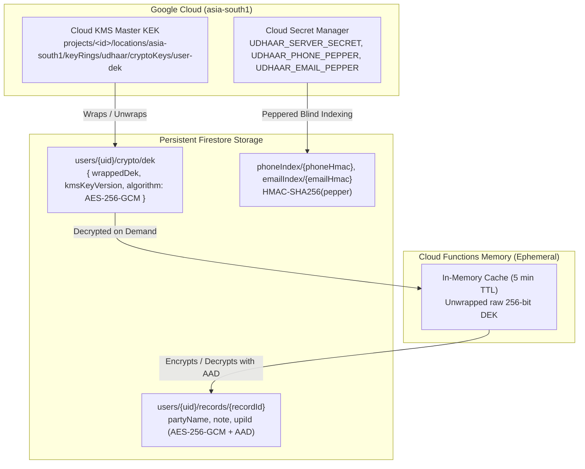

# Operational Runbook: Cryptographic Key & Secret Rotation

- **System**: Udhaar Platform v2
- **Document Version**: 2.0.0
- **Scope**: Cloud KMS Master KEK (`asia-south1`), Per-User DEKs (`users/{uid}/crypto/dek`), and Secret Manager HMAC Peppers
- **Classification**: STRICT CONFIDENTIAL • INTERNAL SRE & SECURITY RUNBOOK

---

## 1. Cryptographic Key Hierarchy

Udhaar implements a two-tier envelope encryption architecture designed for strict DPDP Act compliance and minimal blast radius:



### Key Tiers & Rotation Frequencies
1. **Master Key Encryption Key (KEK)**: Hardware-backed symmetric key in `asia-south1`. Automatically rotated every **90 days**.
2. **Per-User Data Encryption Key (DEK)**: Unique random 256-bit key per user. Wrapped by KEK, stored in Firestore, cached in memory for 5 minutes. Lazily re-wrapped when KEK rotates.
3. **HMAC Peppers & Server Secrets**: Stored in Secret Manager. Rotated manually on annual schedule or immediate security alert with a dual-lookup transition window.

---

## 2. Standard 90-Day Cloud KMS Key Rotation

### 2.1 Automated Rotation
The production Master KEK is configured with an automatic 90-day rotation policy:
```bash
gcloud kms keys describe user-dek \
  --keyring=udhaar \
  --location=asia-south1 \
  --project="${GCP_PROJECT_ID}" \
  --format="yaml(rotationPeriod,nextRotationTime,primary)"
```

### 2.2 Immediate Manual Rotation
If security policy mandates an immediate key rotation outside the automated cycle:

```bash
# 1. Create a new primary key version
gcloud kms keys versions create \
  --key=user-dek \
  --keyring=udhaar \
  --location=asia-south1 \
  --project="${GCP_PROJECT_ID}" \
  --primary

# 2. Verify the new version is PRIMARY
gcloud kms keys versions list \
  --key=user-dek \
  --keyring=udhaar \
  --location=asia-south1 \
  --project="${GCP_PROJECT_ID}"
```

### 2.3 Lazy Re-Wrapping Mechanics
When a new primary key version is promoted:
1. **Existing Ciphertexts**: Old DEKs remain completely decryptable because Cloud KMS retains all prior enabled key versions.
2. **On Next User Request**:
   - `getOrCreateUserDek(uid)` fetches the user's DEK document from `users/{uid}/crypto/dek`.
   - Cloud KMS unwraps the DEK using the historical key version (e.g. `cryptoKeyVersions/1`).
   - The engine detects that the active primary version is now `cryptoKeyVersions/2`.
   - The engine automatically re-wraps the raw DEK with the new primary version.
   - The updated `wrappedDek` and `kmsKeyVersion` are lazily written back to `users/{uid}/crypto/dek`.
3. **Zero Bulk Migration Downtime**: No massive database scan or downtime is required. Active users re-wrap immediately on access.

---

## 3. Secret Manager Pepper Rotation Runbook

When rotating blind-index peppers (`UDHAAR_PHONE_PEPPER`, `UDHAAR_EMAIL_PEPPER`):

### Phase 1: Dual-Lookup Transition Window
To prevent account lockouts during pepper rotation:
1. Stage new secret version in Secret Manager:
   ```bash
   echo -n "new_cryptographic_pepper_32_bytes_len!" | gcloud secrets versions add UDHAAR_PHONE_PEPPER --data-file=-
   ```
2. Enable dual-lookup in auth resolution:
   - Check `phoneIndex/{newHmac}`.
   - If not found, check `phoneIndex/{oldHmac}`.
   - If found under `oldHmac`, migrate user to `newHmac` atomically within a Firestore transaction:
     - Create `phoneIndex/{newHmac}` pointing to `uid`.
     - Delete `phoneIndex/{oldHmac}`.

### Phase 2: Destroy Old Secret Version
Once migration metrics reach 100% or migration period closes:
```bash
gcloud secrets versions destroy <OLD_VERSION_NUMBER> --secret=UDHAAR_PHONE_PEPPER
```

---

## 4. Emergency Compromise Response

### Scenario A: Cloud KMS Key Compromise
1. Immediately create a new primary version and disable the compromised version:
   ```bash
   # 1. Create emergency primary version
   gcloud kms keys versions create --key=user-dek --keyring=udhaar --location=asia-south1 --primary
   
   # 2. Trigger background batch re-wrap job across all users/{uid}/crypto/dek
   npm --prefix functions run batch-rewrap -- --keyRing=udhaar --key=user-dek
   
   # 3. Disable the compromised key version
   gcloud kms keys versions disable <COMPROMISED_VERSION_NUMBER> \
     --key=user-dek --keyring=udhaar --location=asia-south1
   ```

### Scenario B: Secret Manager Secret Leak
1. Add new secret version immediately in Secret Manager.
2. Restart Cloud Functions instances to evict cached runtime environment variables:
   ```bash
   gcloud functions deploy api --region=asia-south1
   ```
3. Destroy the compromised secret version immediately.

---

## 5. Audit Logging & Verification

Verify KMS key access in GCP Cloud Audit Logs:
```bash
gcloud logging read \
  'protoPayload.serviceName="cloudkms.googleapis.com" AND protoPayload.methodName=~"Decrypt|Encrypt"' \
  --project="${GCP_PROJECT_ID}" \
  --limit=20 \
  --format="table(timestamp,protoPayload.authenticationInfo.principalEmail,protoPayload.resourceName)"
```
Ensure that only `udhaar-functions@${PROJECT_ID}.iam.gserviceaccount.com` is making calls to `user-dek`.
